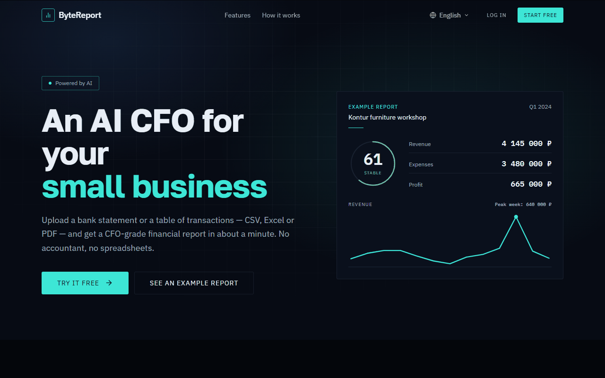
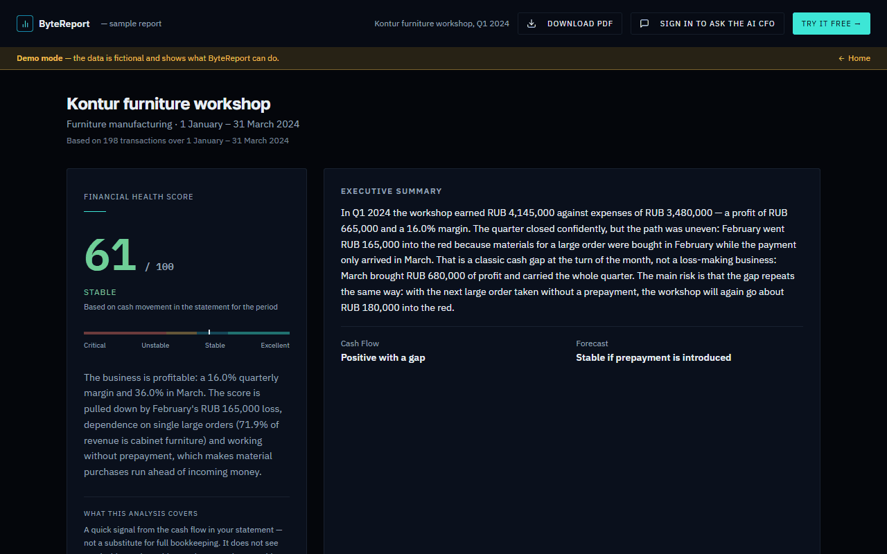
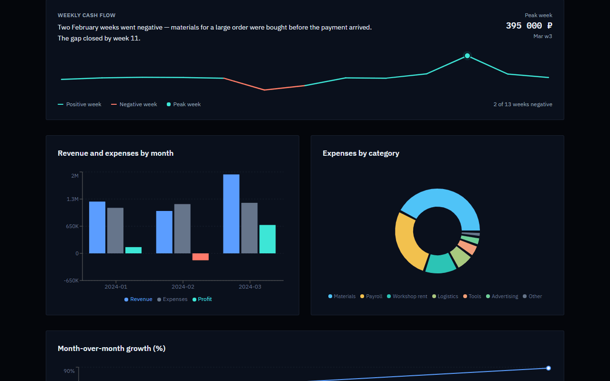
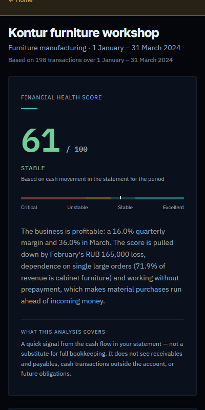
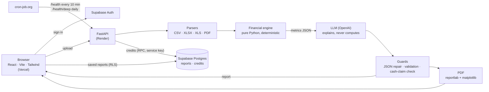

# ByteReport

**Upload a bank statement, get a CFO-style financial report in about a minute — built for small businesses in Uzbekistan and the CIS that have no accountant.**

**Live:** [bytereport-frontend.vercel.app](https://bytereport-frontend.vercel.app) · **Sample report, no sign-up:** [/demo](https://bytereport-frontend.vercel.app/demo) · **Video walkthrough:** coming soon

| Landing | Report |
|---|---|
|  |  |
| **Charts** | **Phone** |
|  |  |

## What it does

1. You upload what your bank gives you: CSV, Excel (new or legacy) or a PDF statement.
2. Python parses it, cleans it (drops future-dated rows, flags likely duplicates, keeps loans out of revenue) and computes every figure: revenue, margin, monthly and weekly flows, anomalies, a cash forecast and a 0–100 health score.
3. An LLM receives those finished numbers and writes the explanation: what happened, the risks, what to do first.
4. You read the report on the web, ask follow-up questions in a chat, or download a branded PDF.

Voice, text and photographed receipts become rows of a spreadsheet the same way.

## Engineering highlights

- **Python computes, the AI explains.** Every number in a report comes from a deterministic engine (`financial_engine.py`). The model gets the computed metrics and writes prose around them. Its output then passes guards: JSON repair, schema validation, removal of any cash-shortfall date or amount it cannot back with an account balance, and, in the chat, replacement of model-made cash figures with the engine's own.
- **About $0.03 per report.** Token usage is logged from the provider's own counts, not estimated (`cost.py`). Three measured production reports cost **$0.034, $0.024 and $0.022** (gpt-4.1; the later two hit the prompt cache).
- **A blocked event loop, found and proven.** The provider SDKs are synchronous; called inside `async def`, each 30–45 s AI request froze the whole server — even `/health` stopped answering. The calls now run in worker threads. A regression test runs a deliberately blocking provider call and checks that a 10 ms heartbeat keeps ticking (`tests/test_chat_concurrency.py`). File parsing had the same flaw (a long PDF silenced `/health` for its whole duration) and is fixed and tested the same way.
- **Real-world input formats.** CSV in three encodings (UTF-8 with or without BOM, Windows-1251, CP866), `.xlsx`, legacy `.xls`, HTML disguised as `.xls`, and text-based PDF bank statements; scanned PDFs are recognised and rejected with a clear message.
- **Built for a 512 MB free host.** Peak memory for a full upload → analysis → PDF run, measured per scenario: 132 MB for a typical file, 191 MB for a 10 MB CSV. A 150-page PDF statement used to peak at 701 MB (pdfplumber kept every page); reading and releasing one page at a time brought it to 140 MB. Statements are capped at 50 pages, counted before any page is parsed, so a long one is refused at once with a clear message instead of outlasting the request timeout on a 0.1-CPU host.
- **Cold start.** Heavy libraries (reportlab, matplotlib, openpyxl, pdfplumber) load on first use: process start → first `/health` answer went from 2.67 s to 1.63 s.
- **Frontend performance.** Route-level code splitting and vendor chunks. Lighthouse performance, landing page, production build, median of three runs: **mobile 75 → 87, desktop 94 → 97**.
- **Three languages.** Russian, Uzbek (Cyrillic) and English across the interface, the AI report, the PDF and the sample report.
- **963 automated tests**, run with `AI_MOCK=1`: no API key, no spend.

## Architecture



## Run it locally

Requirements: Python 3.11, Node 20+.

```bash
# Backend
cd bytereport
python -m venv venv
venv/Scripts/pip install -r requirements.txt      # Windows; venv/bin/pip elsewhere
cp .env.example .env                              # then set AI_MOCK=1
venv/Scripts/uvicorn main:app --reload --port 8000
```

With `AI_MOCK=1` every AI answer comes from a fixture (`app/fixtures/ai_mock.json`): the app works end to end without an OpenAI key and costs nothing. The figures are still computed from your file; the prose says it is a test answer.

```bash
# Frontend
cd bytereport-frontend
npm install
cp .env.example .env      # VITE_API_URL=http://localhost:8000, plus your Supabase URL and anon key
npm run dev
```

```bash
# Tests (backend and frontend checks)
cd bytereport
venv/Scripts/python -m pytest -q
```

The sample report at `/demo` needs neither the backend nor an account.

## Hosting, honestly

This runs on free tiers: Vercel for the web app, Render Free for the API, Supabase Free for auth and data. A free Render service sleeps after 15 minutes without traffic, and **the first request after that can take up to a minute.** A scheduled ping keeps it awake most of the time; when it does sleep, the app says so ("the server is starting, this takes up to a minute") and sends your request by itself once the server answers. The sample report never waits: it does not call the server at all.

Deployment steps: [DEPLOY.md](DEPLOY.md) (in Russian).

## Stack

FastAPI · Pydantic · pandas · pdfplumber · reportlab · matplotlib · OpenAI API · Supabase (Postgres, Auth, RLS) · React 18 · TypeScript · Vite · Tailwind CSS v4 · Recharts · Motion · i18next · Zustand
